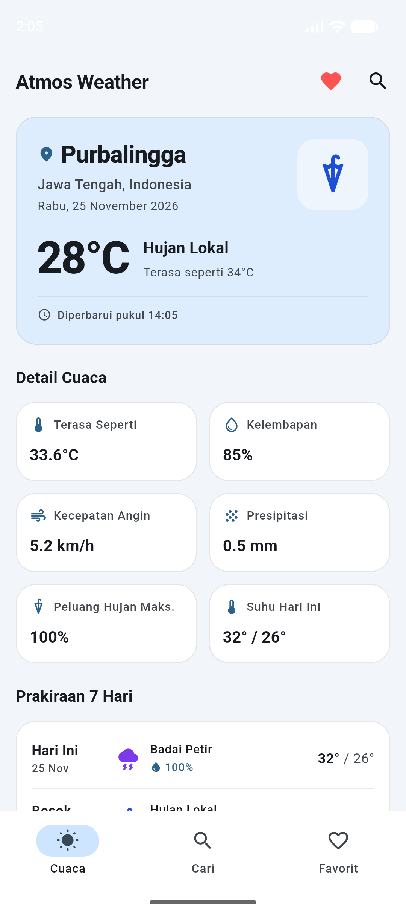
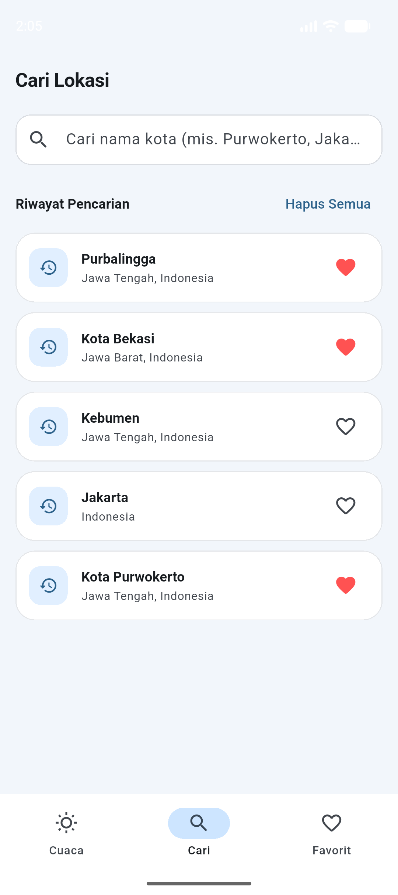
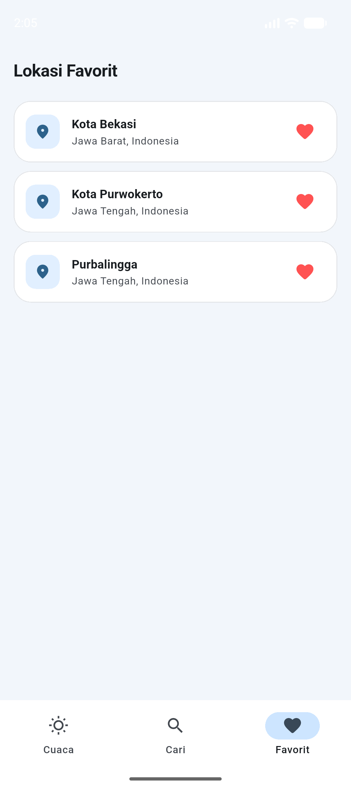

# Atmos Weather

**Atmos Weather** adalah aplikasi prakiraan cuaca berbasis **Flutter** dan **Dart** yang dikembangkan untuk memenuhi kebutuhan **Responsi 2 Praktikum Pemrograman Mobile**. Aplikasi ini menampilkan informasi cuaca terkini dan prakiraan cuaca 7 hari secara *real-time* dari **Open-Meteo API**, lengkap dengan pencarian kota menggunakan Geocoding API, penyimpanan lokasi favorit, serta riwayat pencarian lokal menggunakan `SharedPreferences` dengan arsitektur **MVVM (Model-View-ViewModel)** dan state management **Provider + ChangeNotifier**.

---

## Tangkapan Layar (*Screenshots*)

<div style="display: flex; flex-direction: row; justify-content: center; align-items: flex-start; gap: 16px; flex-wrap: wrap;">
  
  
  
</div>

---

## Fitur Aplikasi

1. **Cuaca Terkini (*Current Weather*)**
   - Menampilkan nama kota terpilih, wilayah administratif/negara, tanggal dalam bahasa Indonesia, suhu saat ini (°C), deskripsi kondisi cuaca (berdasarkan kode cuaca WMO), dan ikon cuaca yang sesuai.
   - Menampilkan detail cuaca: suhu terasa seperti (*feels-like*), kelembapan relatif (%), kecepatan angin (km/h), presipitasi saat ini (mm), peluang hujan maksimum harian (%), serta suhu maksimum/minimum hari ini.
   - Mendukung *pull-to-refresh* menggunakan `RefreshIndicator`.
2. **Prakiraan Cuaca 7 Hari (*7-Day Forecast*)**
   - Menampilkan nama hari dan tanggal singkat dalam bahasa Indonesia (`Hari Ini`, `Besok`, `Senin`, dst.), ikon cuaca, deskripsi kondisi, peluang hujan maksimum, serta suhu maksimum dan minimum harian.
3. **Pencarian Kota (*City Search*)**
   - Pencarian langsung ke **Open-Meteo Geocoding API** dengan mekanisme *debounce* (450 ms) untuk mencegah permintaan jaringan berlebihan saat mengetik.
   - Perlindungan terhadap *race condition* agar respons API yang lama tidak menimpa hasil pencarian terbaru.
   - Tombol hapus input, tombol favorit langsung pada tiap hasil pencarian, serta riwayat pencarian lokal.
4. **Lokasi Favorit (*Favorites*)**
   - Menyimpan dan menghapus kota favorit tanpa duplikasi.
   - Memilih lokasi favorit langsung memuat ulang data cuaca terkini dan berpindah ke layar Cuaca.
5. **Persistensi Data Lokal (*Local Storage*)**
   - Lokasi favorit, riwayat pencarian (maksimal 10 entri terbaru tanpa duplikasi), dan lokasi terakhir yang dipilih disimpan secara persisten dan dipulihkan otomatis saat aplikasi dibuka kembali.
6. **Penanganan State & Error Lengkap**
   - Menangani *loading state*, *empty state*, dan *error state* (tanpa koneksi internet, *timeout*, kesalahan HTTP, respons JSON tidak valid) dengan tombol **Coba Lagi**.
7. **Material Design 3 & Tema Adaptif**
   - Menggunakan Material Design 3 dengan dukungan tema terang (*Light*) dan gelap (*Dark*) yang mengikuti preferensi sistem, serta tata letak responsif.

---

## Teknologi & Dependensi

| Teknologi / Paket | Versi | Kegunaan |
| :--- | :--- | :--- |
| **Flutter & Dart** | SDK `^3.13.7` | Framework pengembangan aplikasi mobile lintas platform |
| **provider** | `^6.1.5+1` | State management berbasis `ChangeNotifier` |
| **http** | `^1.6.0` | Permintaan HTTP GET ke REST API Open-Meteo |
| **shared_preferences** | `^2.5.4` | Penyimpanan lokal persisten (favorit, riwayat, lokasi terakhir) |
| **intl** | `^0.20.2` | Pemformatan waktu |
| **flutter_lints** | `^6.0.0` | Analisis statis dan aturan penulisan kode Dart/Flutter |

---

## Dokumentasi API (Open-Meteo)

Seluruh data lokasi dan cuaca berasal langsung dari REST API resmi **Open-Meteo** (tanpa API key dan tanpa data *hardcoded*).

### 1. Geocoding API (Pencarian Kota)

- **Endpoint:** `GET https://geocoding-api.open-meteo.com/v1/search`
- **Parameter:**
  - `name`: kata kunci nama kota
  - `count`: `10`
  - `language`: `id`
  - `format`: `json`
- **Contoh Request:**
  ```http
  GET https://geocoding-api.open-meteo.com/v1/search?name=Purwokerto&count=10&language=id&format=json
  ```

### 2. Weather Forecast API (Cuaca Terkini & Prakiraan 7 Hari)

- **Endpoint:** `GET https://api.open-meteo.com/v1/forecast`
- **Parameter:**
  - `latitude` & `longitude`: koordinat dari lokasi yang dipilih
  - `current`: `temperature_2m,relative_humidity_2m,apparent_temperature,precipitation,weather_code,wind_speed_10m`
  - `daily`: `temperature_2m_max,temperature_2m_min,precipitation_probability_max,weather_code`
  - `timezone`: `auto`
  - `forecast_days`: `7`
- **Contoh Request:**
  ```http
  GET https://api.open-meteo.com/v1/forecast?latitude=-7.4246&longitude=109.2396&current=temperature_2m,relative_humidity_2m,apparent_temperature,precipitation,weather_code,wind_speed_10m&daily=temperature_2m_max,temperature_2m_min,precipitation_probability_max,weather_code&timezone=auto&forecast_days=7
  ```

---

## Arsitektur MVVM

Aplikasi menerapkan pola arsitektur **Model-View-ViewModel (MVVM)** yang dikombinasikan dengan lapisan **Service** untuk menjaga pemisahan tanggung jawab (*Separation of Concerns*):

```text
View (UI Widgets & Screens)
   │  mendengarkan perubahan state via Provider / Consumer
   ▼
ViewModel (ChangeNotifier)
   │  mengelola state, validasi, debounce, dan alur data
   ▼
Service (GeocodingService, WeatherService, LocalStorageService)
   │  komunikasi HTTP GET & persistensi SharedPreferences
   ▼
Model (LocationModel, CurrentWeatherModel, DailyForecastModel, WeatherResponseModel)
```

### Tanggung Jawab Tiap Lapisan

- **Model (`lib/models/`)**
  Merepresentasikan struktur data aplikasi dan respons JSON dari Open-Meteo API. Bertanggung jawab atas deserialisasi (`fromJson`) dan serialisasi (`toJson`) dengan tipe data yang kuat (*strongly typed*), tanpa ketergantungan pada kode UI.
- **Service (`lib/services/`)**
  Menangani seluruh logika jaringan HTTP GET (`GeocodingService`, `WeatherService`) lengkap dengan *timeout* dan pemetaan kesalahan, serta logika penyimpanan lokal (`LocalStorageService`) menggunakan `SharedPreferences`.
- **ViewModel (`lib/viewmodels/`)**
  Mewarisi `ChangeNotifier` (`WeatherViewModel`, `SearchViewModel`, `FavoritesViewModel`). Memanggil Service untuk mengambil/menyimpan data, mengelola state *loading*, *success*, *empty*, dan *error*, mencegah *race condition*, lalu memicu pembaruan UI melalui `notifyListeners()`.
- **View (`lib/views/` & `lib/widgets/`)**
  Bertanggung jawab semata-mata untuk merender antarmuka Material Design 3 dan meneruskan interaksi pengguna ke ViewModel. Tidak ada permintaan HTTP ataupun akses `SharedPreferences` di dalam widget.

---

## Struktur Folder Proyek

```text
lib/
├── main.dart
├── app.dart
├── core/
│   ├── constants/
│   │   ├── api_constants.dart
│   │   └── app_constants.dart
│   ├── theme/
│   │   └── app_theme.dart
│   └── utils/
│       ├── date_formatter.dart
│       └── weather_code_helper.dart
├── models/
│   ├── current_weather_model.dart
│   ├── daily_forecast_model.dart
│   ├── location_model.dart
│   └── weather_response_model.dart
├── services/
│   ├── geocoding_service.dart
│   ├── local_storage_service.dart
│   └── weather_service.dart
├── viewmodels/
│   ├── favorites_viewmodel.dart
│   ├── search_viewmodel.dart
│   └── weather_viewmodel.dart
├── views/
│   ├── favorites/
│   │   └── favorites_screen.dart
│   ├── home/
│   │   └── home_screen.dart
│   └── search/
│       └── search_screen.dart
└── widgets/
    ├── current_weather_card.dart
    ├── empty_state_widget.dart
    ├── error_widget.dart
    ├── forecast_list.dart
    ├── loading_widget.dart
    ├── location_list_tile.dart
    ├── location_search_field.dart
    └── weather_details_grid.dart
```

---

## Implementasi Penyimpanan Lokal

Penyimpanan lokal dikelola secara terpusat melalui `LocalStorageService` (`lib/services/local_storage_service.dart`) menggunakan `SharedPreferences`:

| Kunci Penyimpanan | Data yang Disimpan | Perilaku |
| :--- | :--- | :--- |
| `atmos_favorite_locations` | Daftar `LocationModel` (JSON Array) | Mencegah duplikasi; dipulihkan otomatis saat aplikasi dibuka |
| `atmos_search_history` | Daftar `LocationModel` (JSON Array) | Pencarian terbaru berada di urutan paling atas, tanpa duplikasi, dibatasi maksimal 10 entri |
| `atmos_last_selected_location` | Objek `LocationModel` (JSON Object) | Memulihkan kota terakhir yang dilihat pengguna saat aplikasi dijalankan ulang |

Jika data tersimpan hilang atau rusak (*corrupted JSON*), `LocalStorageService` menanganinya secara aman dengan mengembalikan daftar kosong atau `null` tanpa menyebabkan *crash*.

---

## Instalasi

Pastikan Flutter SDK telah terpasang di perangkat Anda.

1. Kloning atau buka direktori proyek:
   ```bash
   cd atmosweather
   ```
2. Unduh seluruh dependensi proyek:
   ```bash
   flutter pub get
   ```

---

## Cara Menjalankan Aplikasi

1. Pastikan emulator Android, simulator iOS, atau perangkat fisik sudah terhubung:
   ```bash
   flutter devices
   ```
2. Jalankan aplikasi:
   ```bash
   flutter run
   ```

---

## Pengujian (*Testing*)

Seluruh unit test dan widget test menggunakan *mock HTTP client* dan *mock SharedPreferences*, sehingga dapat dijalankan secara cepat dan stabil tanpa bergantung pada koneksi internet.

1. Format kode:
   ```bash
   dart format .
   ```
2. Analisis statis:
   ```bash
   flutter analyze
   ```
3. Jalankan seluruh pengujian:
   ```bash
   flutter test
   ```
